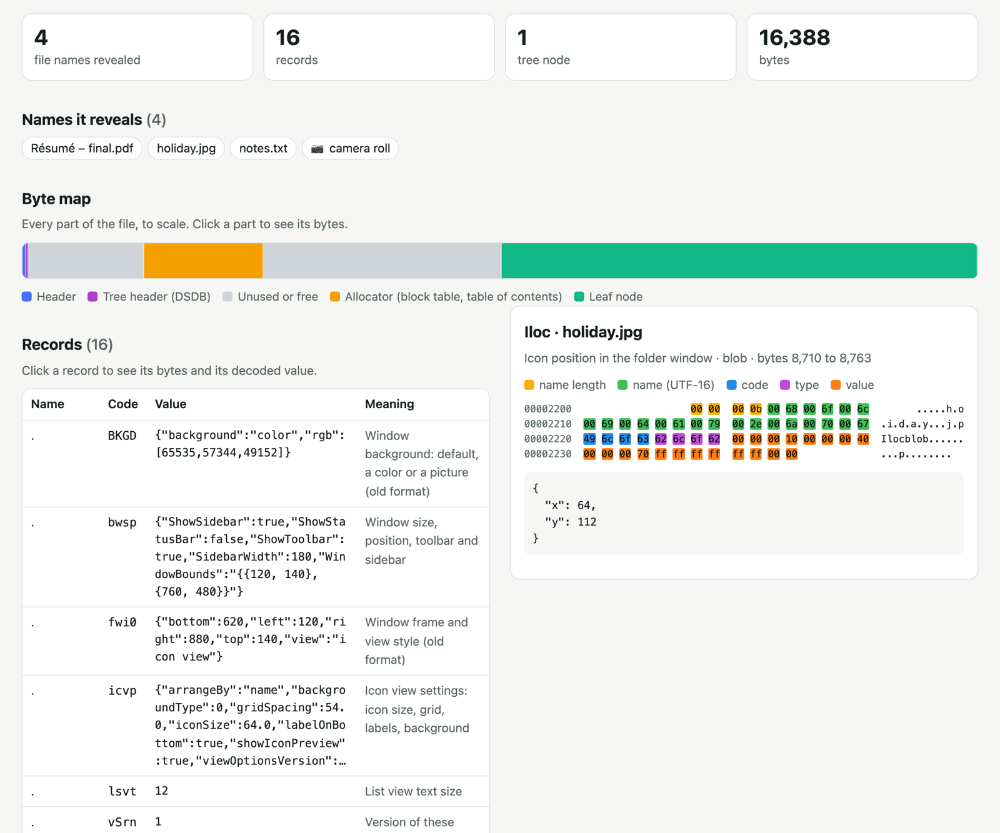

# dsxray

**X-ray Apple's `.DS_Store` files: every record, what it means, where its bytes are, and which file
names it leaks.** A Rust parser that runs as a command-line tool and, compiled to WebAssembly, in
your browser.

**Try it: [sadmansakib811.github.io/dsxray](https://sadmansakib811.github.io/dsxray/)**. Drop a
file in, or click *Try a sample*. Nothing is uploaded.

[](https://github.com/sadmansakib811/dsxray/actions/workflows/ci.yml)




## Why

macOS Finder writes a hidden `.DS_Store` into every folder it opens: icon positions, window sizes,
view settings, Spotlight comments, and the Trash's record of where deleted files came from. Each
record is keyed by a **file name**. So when a `.DS_Store` ships with a website or lands in a
repository, anyone can download it and read which files sit in that folder, including the ones that
were never linked.

On my own Mac, `dsxray scan` found 79 of these files naming 825 files. dsxray shows you what yours
say, and stops a deploy that would publish one.

## What it does

- **Reads every record** and explains it in plain words: `Iloc` is an icon position, `bwsp` the
  window settings (a binary property list, decoded), `ptbL` the folder a trashed file came from.
- **Lists the names a file gives away**, the part that matters for privacy.
- **Maps every byte** (in the browser): header, allocator, tree header, branch and leaf nodes, free
  space, and each record split into name length, name, code, type and value.
- **Scans folders before you publish them**: `dsxray scan ./public` exits with 1 when it finds a
  `.DS_Store`, so it can fail a CI job.
- **Treats every file as hostile**: bounds-checked reads, no `unsafe` in the parser, a tree walk that
  refuses loops and impossible depths, and damage reported with the records read before it.

## Command line

Install with Rust (or download a binary from the [releases](https://github.com/sadmansakib811/dsxray/releases)):

```sh
cargo install --locked --git https://github.com/sadmansakib811/dsxray dsxray
```

Look inside a file:

```console
$ dsxray crates/dsxray/tests/fixtures/small.DS_Store
crates/dsxray/tests/fixtures/small.DS_Store: 16388 bytes, 16 records about 4 names, in a tree of 1 node

It reveals these names (4):
  Résumé – final.pdf
  holiday.jpg
  notes.txt
  📷 camera roll

NAME                          CODE  VALUE                                         MEANING
.                             bwsp  {"ShowSidebar":true,"ShowStatusBar":false,"…  Window size, position, toolbar and sidebar
.                             vstl  icon view                                     View style the folder opens in
holiday.jpg                   Iloc  x=64, y=112                                   Icon position in the folder window
notes.txt                     cmmt  "remember to back this up"                    Spotlight comment typed in Get Info
📷 camera roll                 modD  2026-10-19T12:00:00Z                          Modification date (cached)
…
```

`--json` prints everything (raw values, decoded values, byte offsets, the byte map); `--names` only
the names.

Check a folder before you publish it:

```console
$ dsxray scan ./site
Found 2 .DS_Store files under ./site (revealing 304 names):
  ./site/.DS_Store  4 names: Résumé – final.pdf, holiday.jpg, notes.txt, 📷 camera roll
  ./site/assets/img/.DS_Store  300 names: photo-0000.jpg, photo-0001.jpg, photo-0002.jpg, photo-0003.jpg, …
Delete them before you publish this folder, and add .DS_Store to .gitignore.
$ echo $?
1
```

In a GitHub Actions deploy:

```yaml
- name: No .DS_Store goes out with the site
  run: |
    curl -sSL https://github.com/sadmansakib811/dsxray/releases/latest/download/dsxray-x86_64-unknown-linux-gnu.tar.gz | tar xz
    ./dsxray scan ./public
```

## As a library

```rust
let bytes = std::fs::read(".DS_Store")?;
let store = dsxray::parse(&bytes)?;
for name in store.file_names() {
    println!("{name}");
}
for record in &store.records {
    let d = dsxray::describe(record);
    println!("{} {} {}", record.name, record.code, d.summary);
}
```

## How it works

The format is undocumented. It is a small **buddy allocator** (a file split into power-of-two
blocks) holding a **B-tree** of records. [docs/FORMAT.md](docs/FORMAT.md) walks through a real file
byte by byte: the header, the block table, the tree header, branch and leaf nodes, and a record.

```
crates/dsxray        the parser (no unsafe), plain-language meanings, JSON, and the CLI
crates/dsxray-wasm   the browser build: 4 exported functions, no imports, no JS glue
web/                 the page: plain HTML, CSS and JavaScript, no framework
```

The browser build doesn't use wasm-bindgen. It exports `dsx_alloc`, `dsx_inspect` and `dsx_free`:
the page copies the file into the module's memory, calls `dsx_inspect`, and reads back a JSON
answer whose address and length come packed into one 64-bit number. The module is 216 KB and
imports nothing, so it can't reach the network even if it wanted to.

## Testing

- **Fixtures from an independent implementation.** The test files are written by Alastair
  Houghton's Python library `ds_store` (`scripts/make_fixtures.py`). Its writer corrupts trees once a
  node splits, so the multi-level fixture is packed by hand and checked with `ds_store`'s reader.
- **Differential test on real files.** `scripts/differential.py` reads every `.DS_Store` under the
  folders you give it with both dsxray and `ds_store` and compares every record, printing only
  counts. On one Mac: 79 Finder-made files, 1,962 records, all identical. The real files stay
  private.
- **Hostile input.** Every truncation of the fixtures, 20,000 randomly damaged copies, and a node
  pointing back at itself: no panics, no hangs, and a clear reason.
- CI runs formatting, Clippy with warnings as errors, and the tests on Linux, macOS and Windows,
  builds the browser module and checks it in Node.

## Credits

The format was reverse-engineered by Mark Mentovai, Wim Lewis
([DSStoreFormat.pod](https://metacpan.org/dist/Mac-Finder-DSStore/view/DSStoreFormat.pod)) and
Alastair Houghton ([ds_store](https://github.com/al45tair/ds_store)). Other Rust parsers exist
(`ds_store`, `ds_parser` on crates.io); dsxray focuses on explaining files, showing their bytes,
reading hostile input safely, and catching leaks before a deploy.

## License

MIT
